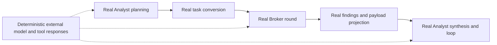

# Proposal: Analyst–Tool Broker compatibility and behavior gates

**Status: Draft for developer agreement. Do not implement or auto-merge this proposal.**

This PR changes documentation only. It proposes additional tests and CI gates; it does not change application behavior, tests, dependencies, ownership rules, or GitHub settings. The repository's normal checks-only auto-merge policy remains in place for other work. This planning PR is an explicit exception because the owner requested developer agreement before implementation.

## Goal and limits

Let developers change the main Analyst and the Tool Broker independently while catching incompatible handoffs and agreed behavior regressions before merge. Every implementation PR should demonstrate that both sides still work together against the current `main`.

Tests enforce specified expectations, not every possible future behavior. Passing tests does not prove that an LLM's live conclusion is correct. File ownership, interface compatibility, deterministic pipeline behavior, and live model quality are separate concerns. This proposal does not prohibit all cross-component edits or claim that a repository can protect itself against an administrator deliberately removing its protections.

## References and source of truth

The inspection baseline is main commit [`83f67a0e8ddc57997298b8c926d12602e8455f49`](https://github.com/zerogravity-reno/smartops-soc-app/tree/83f67a0e8ddc57997298b8c926d12602e8455f49), merged through PR #8. All observations below refer to that revision. Recheck them against `main` before implementation.

An agreed behavior must have an acceptance criterion, a source reference, and an owner. Current code and tests establish what happens today; developers and the product owner decide whether that behavior should be preserved or changed. Historical incident reports supply regression candidates, not automatic product requirements. Conflicts become explicit decisions rather than silently choosing whichever document or implementation is convenient.

| Reference | What it establishes | What it does not establish |
|---|---|---|
| [Main Analyst](../engine/src/smartops/analyst.py): `investigate`, `to_task_file`, `_broker_round` | Current planning, task conversion, Broker invocation, synthesis, and loop behavior | That today's verdict policy is the desired permanent policy |
| [Tool Broker](../engine/src/smartops/broker.py): `run_round`, `RoundResult` | Actual in-process boundary and round outcomes | A separately versioned public Python API |
| [Task input models](../engine/contracts/src/contracts/task_input.py), [findings/payload models](../engine/contracts/src/contracts/reasoning.py), and [published schemas](../engine/contracts/schemas) | Existing serialized task, findings, and Analyst payload shapes | That the internal `RoundResult` and serialized payload are interchangeable |
| [Published-schema tests](../engine/contracts/tests/test_published_schema.py) | Schema/model agreement, required join keys, exclusions from the wire, and preservation of the old v1 findings schema | Complete producer/consumer compatibility for every change |
| [Handoff tests](../tests/test_analyst_handoff.py), [Broker-round tests](../tests/test_broker_round.py), [Analyst-loop tests](../tests/test_analyst_loop.py), [verdict tests](../tests/test_verdict_gate.py) | Existing task, event, cancellation, and verdict expectations | A real joined workflow where some of these tests substitute the Broker |
| [Projection tests](../engine/tests/test_projection.py), [guards](../engine/tests/test_guards.py), [budget tests](../engine/tests/test_budget.py) | Existing evidence, scope, time-window, and budget protections | That those protections survive the entire Analyst-to-Broker round trip |
| [Replay support](../engine/src/smartops/replay.py) and [replay tests](../engine/tests/test_replay.py) | Reusable offline tool evidence and exclusion of model-authored answers from evidence | Offline replay of the full Analyst workflow without additional test work |
| [Frontend/API contract](frontend-api-contract.md) | Documented event and payload shapes visible to the UI | A substitute for exercising the actual HTTP/SSE behavior |
| [Issue report](smartops-issues-report.md), [Analyst handoff](analyst-handoff-2026-10-06.md), [AR13/AR14 validation](mcp-ar13-ar14-live-2026-10-13.md) | Historical failures and explicit limits of past live validation | Current architecture documentation or proof that all reported issues remain open |
| [Current CI](../.github/workflows/ci.yml) and [main ruleset](../.github/main-ruleset.json) | Current Python/frontend checks, final `SmartOps CI` gate, and intended checks-only merge policy | Protection against a contributor changing both tests and implementation |

Some historical documents still name removed `webapp/` paths. Use the current source locations above rather than implementing against those historical paths.

## Proposed ownership boundaries

The requester identified Yousef Salah for the Analyst and Mohamed Rahmy for the Tool Broker. Their agreement to this specification is still pending. The repository maintainer's sign-off role remains to be confirmed; a person may own more than one area.

| Area | Proposed scope | Reviewer/decision owner |
|---|---|---|
| Main Analyst | `analyst.py`, its prompt, planning, synthesis, follow-up decisions | Yousef Salah, [@ysalahai](https://github.com/ysalahai) — agreement pending |
| Tool Broker | `broker.py`, `subagents/`, `subagent_analysts/`, tool execution, projection, packing | Mohamed Rahmy, [@mrahmy-reno](https://github.com/mrahmy-reno) — agreement pending |
| Shared integration | `engine/contracts/`, task/payload adapters, shared event meanings, joint scenario fixtures | Both component owners |
| CI enforcement | `.github/workflows/`, required-check names, ruleset, trusted regression policy | Repository maintainer: TBD |

The Broker's `subagent_analysts/` are not the main Analyst; the similar names must not imply the wrong ownership. Shared modules such as telemetry can affect both components even if a PR changes only a Broker-owned file. Ownership identifies coordination responsibilities; without required owner review it does not block edits to a path.

## Proposed tests and gates

### 1. Producer/consumer compatibility

Expand the existing contract tests rather than replacing them. For each supported interface version:

- Validate the main Analyst's produced task files against the Broker's accepted contract and execute the real task conversion.
- Validate actual Broker findings and projected Analyst payloads against the main Analyst's consumer expectations. Test the wire payload as well as the in-process `RoundResult` boundary.
- Run accepted historical/synthetic input fixtures through the new consumer. Validate new producer output against the baseline consumer contract where mixed revisions are supported.
- Detect removed required fields, incompatible types or enum meanings, lost task/hypothesis identifiers, altered units/time semantics, and reintroduced fields that must stay out of the wire payload.
- For breaking changes, add a new version and a migration plan; preserve already-published versions. Owners must explicitly agree which mixed-version combinations and compatibility window are supported. A JSON Schema comparison alone cannot prove semantic compatibility.

Baseline contracts and fixtures must come from a recorded trusted base revision, not from a file regenerated from the proposed models in the same PR. Define allowed additive changes before selecting or writing a schema-diff check. Do not add a dependency until the implementation spike establishes a need.

### 2. Real joined workflow, deterministic external responses

Exercise `investigate` through the real handoff, `broker.run_round`, result projection/packing, and synthesis/loop handling. Replace only external model responses and external tool/service transports with controlled fixtures. Do not replace `_broker_round`, `run_round`, or the handoff/packing functions whose integration the test is meant to protect.

Reuse the existing replay tools and fixture patterns where they fit. A short spike must demonstrate supported injection points and one real round before promising the complete harness. If a production seam must change, describe the smallest change in a separate reviewed implementation PR; avoid a broad refactor.

Required test properties: no service credentials, no outbound service calls, no billable models, temporary run directories, controlled clocks/IDs where necessary, bounded completion, and assertions on semantics rather than exact prose or volatile timestamps. Fail on unexpected outbound calls rather than falling back to a live provider.

### 3. Shared acceptance scenarios

The following are **candidates for agreement**, not newly imposed application requirements. Each final scenario needs a fixture ID, source reference, exact expected assertions, component owner, and status of proposed/accepted/deferred.

| Candidate | Observable acceptance criterion | Reference to investigate |
|---|---|---|
| Successful round trip | Accepted tasks reach the real Broker, expected findings return, and task/hypothesis/evidence links survive | Handoff, projection, payload contracts |
| Invalid or partly usable task | Existing validation/narrowing rules apply; every rejected or narrowed task is recorded explicitly | `test_analyst_handoff.py` |
| Tool returns no rows | Confirmed empty search remains distinguishable from unavailable or unsearched data | Projection tests and AR13 |
| Tool unavailable or session lost | Missing evidence stays explicit; agreed round termination/retry behavior completes within the test bound | AR13/AR14 and the documented inconclusive B24 attempt |
| Partial success | A successful source's data survives another source's failure; missing sources remain explicit | Broker round and domain-gap behavior |
| Follow-up round | Entities and windows follow the agreed inheritance rules, prior questions are not silently repeated, and iteration is bounded | Handoff and Analyst-loop tests |
| Cancellation or timeout | A stopped run does not continue scheduling work or emit a successful terminal event; teardown finishes | Broker-round and run-control tests |
| Scope/time/budget enforcement | Disallowed searches remain blocked, event time remains correctly normalized, and accounting limits remain enforced through the joint path | Guards, budget, UTC tests |
| Model generation cut off | Truncated plan or synthesis remains an explicit failure rather than a fabricated completed result | Analyst-loop tests |
| API/SSE smoke | Actual API emits agreed event order and one appropriate terminal event for the fixture | Frontend/API contract and run-control tests |

Do not freeze a particular live model verdict or confidence score as a deterministic infrastructure test. For example, current `test_confident_but_uncited_reaches_a_verdict` and `test_refs_are_informational` explicitly allow a confident verdict without valid evidence citations. Whether that should change is a product/Analyst decision; adding a citation-enforcement gate would change behavior and needs separate agreement.

### 4. Architecture checks

Inventory existing imports and supported interfaces before adding a blocking import rule. Start by reporting new dependencies on the other component's private functions or state. Block new violations only after owners agree the allowed dependency map and existing exceptions. Do not enforce a fictional separation: today the main Analyst legitimately imports the Broker entry points, and some integration is shared.

### 5. Required CI integration

Keep the existing Python/frontend checks and run the complete relevant suites on all PRs, including changes to shared dependencies, prompts, and fixtures. Proposed additional job names are `Contract compatibility`, `Analyst-Broker integration`, and later `Architecture boundaries`; names are provisional until implemented.

Add each new blocking job to the dependencies of the existing required `SmartOps CI` aggregate. Its `always()` final job must fail when any required dependency fails, is cancelled, or is skipped. A zero-test run, unexpected missing fixture, or unexecuted scenario cannot count as a pass. Keeping the existing aggregate name avoids an unnecessary required-check rename or a gap in protection.

Require the tested commit to be the current PR head and keep the existing up-to-date-main requirement. GitHub PR CI must test the combined PR/base revision; a check on an old feature commit is insufficient after another developer's change merges. Consider merge queues later if PR volume warrants it; enabling a queue would also require a `merge_group` workflow trigger and is not part of this proposal.

Live Splunk/Bedrock/Anthropic validation remains separate from the deterministic PR gate. If introduced later, it needs a controlled environment, explicit authorization, stable data, cost limits, and a stated pass criterion. The existing live report explicitly did not exercise the full Analyst verdict path.

## Protecting the protection

Checks-only merging cannot guarantee that a contributor has not weakened the workflow, regression fixtures, and implementation together. Agree one of these options before claiming stronger enforcement:

1. Keep checks-only merging and acknowledge this trust limitation. Detect suspicious test/workflow changes for visibility, but do not call detection alone an unchangeable security boundary.
2. Keep routine changes automatic, but require designated-owner review for CI, shared contract policy, and regression baselines. This is a deliberate exception to the current zero-human-approval preference. `CODEOWNERS` only enforces approval when the corresponding GitHub protection requires it; a file alone is advisory.
3. Put mandatory workflows/baselines under separately controlled organization/repository policy where the GitHub plan supports it. Confirm plan support and administrative ownership first; do not assume this control is available.

This PR does not choose an option or add `CODEOWNERS`. It also does not add path restrictions that could stop legitimate coordinated interface changes.

## Delivery plan after agreement

| Phase | Deliverable | Exit criterion before the next phase |
|---|---|---|
| 0. Agree the specification | Named owners, supported version policy, accepted scenarios, and protection option recorded in this PR | Analyst owner, Broker owner, and repository maintainer explicitly agree; product owner resolves behavior-policy questions |
| 1. Prove the harness | One deterministic real Analyst-to-Broker-to-Analyst round and a documented injection approach | Both component owners confirm the real boundary is exercised; no live services or bills |
| 2. Add compatibility and regressions | Separate focused PRs with the approved fixtures, contracts, and scenarios | Existing suites pass; every new test is shown to fail for its intended regression |
| 3. Observe in CI | Run new jobs without weakening or renaming the existing required gate | Results are visible on PRs; agreed repeat-run/runtime criteria met and failures diagnosed |
| 4. Enforce | Add accepted jobs to `SmartOps CI`; enforce agreed architecture and trusted-baseline controls | Required jobs block a deliberately failing example, pass a valid example, and leave no skipped-job loophole |

Demonstrate effectiveness with temporary/local mutations such as dropping a task ID, renaming a consumed field, or turning an unavailable source into an empty result. The intended test must fail; remove each mutation before committing. Do not change production assertions to get a green demonstration. Proposed pilot budget: at most five minutes for the added deterministic jobs on the standard GitHub runner, with five consecutive unchanged runs completing without an unexplained failure. Owners must accept or revise these targets before implementation; five runs do not prove absence of flakiness.

Each implementation PR must link the accepted scenario/specification, identify the affected components, preserve unrelated developer work, and state remaining limitations. If a proposed test fails on existing behavior, stop and resolve the behavior question with its owner; do not silently change the other developer's implementation. Roll back a newly added gate through a PR if a confirmed harness defect blocks work; retain the existing required CI and document why. Do not bypass main protection or silently disable an assertion.

## Decisions and agreement record

Reply in the planning PR so the agreement stays with the repository. Replace each TBD with an explicitly confirmed GitHub user/team; commit authorship is not owner approval.

- [ ] Analyst owner: Yousef Salah (@ysalahai) — confirms scope and synthesis/follow-up expectations.
- [ ] Broker owner: Mohamed Rahmy (@mrahmy-reno) — confirms task acceptance, outcome semantics, and supported injection points.
- [ ] Repository maintainer: TBD — confirms CI budget and protection option 1, 2, or 3.
- [ ] Supported producer/consumer versions and breaking-change migration policy agreed.
- [ ] Acceptance-scenario matrix agreed, including any deferred cases.
- [ ] Citation/verdict policy and unknown-versus-negative evidence behavior explicitly agreed or kept unchanged with the disputed gate deferred.
- [ ] Runtime/repeatability targets and enforcement rollout agreed.
- [ ] Product owner records authorization to begin the agreed implementation.

Suggested response: “I own [area]. I agree with [sections/scenarios], request changes to [items], and accept/defer [open decisions].” Resolve disagreements in the draft before creating implementation PRs. Keep this PR in draft with auto-merge disabled until the owner confirms developer agreement and asks to proceed; passing the existing CI is not agreement to this specification.
