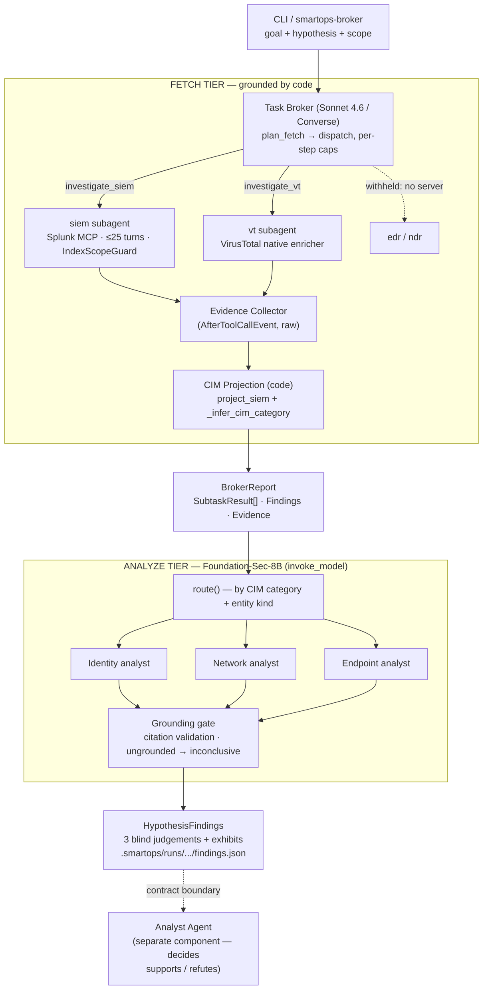

# SmartOps SOC — System Architecture

This is the consolidated, end-to-end architecture of the SmartOps SOC engine: how
one hypothesis becomes a grounded, cited conclusion. It covers both halves of the
pipeline — the **fetch** tier (Task Broker + domain subagents) and the newer
**analyze** tier (three domain analysts + a grounding gate).

> **Related docs.** This file is the single map of the whole system. Three
> companion pages go deeper per subsystem and are the ones `docs/check_anchors.py`
> validates: `confluence-task-broker-architecture.md` (the fetch tier),
> `confluence-findings-pipeline-evidence-store.md` (evidence and the link
> contract), `confluence-subagent-analysts.md` (the analysts; untracked by
> design). `docs/PROJECT_DOCS.md` is the decision record, compiled from
> `docs/sessions/` — never edited directly. `docs/archive/` holds superseded
> architecture prose, kept for the reasoning it records.

---

## 1. Overview

The engine runs in two phases with a hard wall between them:

1. **Fetch (grounded by code).** A **Task Broker** (Claude Sonnet on Bedrock, via
   the Converse API) decomposes a goal into a bounded fetch plan and dispatches it
   to domain subagents — `siem` (Splunk over MCP) and `vt` (VirusTotal, native).
   The subagents retrieve telemetry; **code** — never a model — assembles the raw
   tool output into typed, cited `Findings`. The Broker is deliberately fenced out
   of drawing conclusions.

2. **Analyze (grounded by a gate).** Three **subagent-analysts** — identity,
   network, endpoint — each read their routed slice of the fetched evidence and
   translate it into plain English narration with cited observations, never judging
   what the evidence means. They run on a Bedrock **custom-imported** reasoning
   model (Cisco **Foundation-Sec-8B-Reasoning**, Llama-3.1-8B, 32k context). A
   citation-validation gate drops any fabricated citation and verifies grounding
   of claims.

   **The analysts never see the hypothesis.** An analyst told "20 auth events means
   malicious" and then shown 20 auth events reports malicious — that is the
   hypothesis talking, not the evidence. So they judge the *evidence*, and whether it
   supports or refutes the *claim* is decided one level up, by the Analyst Agent,
   across the `HypothesisFindings` contract. **There is no combiner in this
   codebase**, deliberately — see section 7.

The design invariant throughout: **conclusions must be grounded in evidence the
system actually retrieved, and neither a model's rows nor its citations are taken
on trust.**

---

## 2. Diagram



The same shape, ASCII (for terminals that do not render mermaid):

```
CLI → Task Broker (Sonnet) ─┬─ investigate_siem → Splunk MCP ─┐
                            └─ investigate_vt   → VirusTotal  ─┤
                               (edr/ndr withheld — no server)  │
                                                               ▼
                          Evidence Collector → CIM Projection (code)
                                                               ▼
                                    BrokerReport (typed Findings + Evidence)
                                                               ▼
                                 route()  →  identity / network / endpoint
                                        (Foundation-Sec-8B, invoke_model)
                                                               ▼
                    grounding gate → HypothesisFindings (findings.json)
                                                               ╎
                                          ╎ contract boundary  ╎
                                                               ▼
                                Analyst Agent — decides supports / refutes
                                        (separate component, owned elsewhere)
```

---

## 3. Fetch tier

### Task Broker — `smartops.broker`
An **agent, not an orchestrator**: its *choice of which family tool to call is the
classification decision*, so there is no separate classifier. It must call
`plan_fetch` to author a bounded `FetchPlan` before any dispatch, then dispatch each
step by `step_id`. Dispatch is bounded by code: `DISPATCHES_PER_PLANNED_STEP` (2 per
step) and `MAX_PLANNED_DISPATCHES_PER_FAMILY` (6), and every refusal is a returned
tool result so the model can self-correct. Runs on Sonnet via Converse; its
cumulative output ceiling is set by `--broker-output-tokens` (default 16000 — the
library default of 4000 is too low for Sonnet 4.6's thinking and caused
`limit_output_tokens` before any dispatch).

### siem subagent — `smartops.subagents`
A real Strands agent loop over the Splunk MCP toolset, up to `--subagent-turns`
turns (default **25**; library `DEFAULT_TURNS = 14`). It sees full tool results
(`SlidingWindowConversationManager(should_truncate_results=False)`), so it can
discover schemas, aggregate, and pivot indicators across turns. The system prompt
enforces **stopping conditions** (stop early once categories are covered, reserve
the final turn to report) and **CIM tagging** (every query reported in `queries_run`
with its category). Two guards apply:
- **`IndexScopeGuard`** (`smartops.guards`) cancels unconstrained / `index=*`
  searches before they run — a correctness/safety control, not full field
  optimization.
- **`superman-splunk` skill pack** (`smartops.skills`, `--skills` /
  `SMARTOPS_SKILLS_ENABLED`, **off by default**) injects a routing table + a
  `read_reference` tool giving `| tstats` datamodel guidance, SPL syntax, CIM
  schemas, sourcetypes, and investigation playbooks. Off by default so a measured
  run is a clean baseline.

### vt subagent — `smartops.tools.native.virustotal`
A model-free enricher: the entity kind selects the lookup, so `vt` answers with no
model and no MCP server. Reachable directly through native `@tool`s.

### edr / ndr
Registered as `DomainSpec`s but **withheld** from the Broker's toolset when no MCP
server is configured — a precondition (fact), not a judgement, so they are neither
planned nor dispatched today.

---

## 4. Evidence & CIM projection

The **two-layer payload** is the core anti-fabrication mechanism
(`contracts/findings.py`):
- **`Assessment`** is model-authored and small (a judgement about coverage).
- **`Findings`** is **code-assembled** from raw tool output and holds the rows.

`_EvidenceCollector` (`smartops.subagents`) captures raw tool output via an
`AfterToolCallEvent` hook, at `HookOrder.SDK_FIRST` so it records the true payload
before any offloader rewrites it. Per the `Evidence` contract, **raw output is never
shown to a model**; only code-assembled findings and citations cross that boundary.

`project_siem` (`smartops.projection`) buckets each result set into a CIM category:
`dns_resolutions`, `connections`, `processes`, `auth_events`. The category comes
from the model's own `QueryRun.category`; when that is missing, `_infer_cim_category`
derives it from the SPL predicates (e.g. `stream:dns` → dns_resolutions,
`EventCode=4688` → processes). Anything still untagged lands in `uncategorised` — an
**honesty bucket**: the rows were retrieved and paid for, so they are kept and
surfaced, never dropped. `VtFindings` carry projected reputation `VtVerdict`s.

---

## 5. Analyze tier (`smartops.subagent_analysts`)

The analysts consume the `BrokerReport`. Everything up to the model call is code.

- **Routing — `routing.py`.** `route(report, scope)` splits findings by CIM category
  and entity kind: identity ← `auth_events`; network ← `dns_resolutions` +
  `connections` + VT verdicts for ip/domain/url; endpoint ← `processes` + VT verdicts
  for file_hash. `uncategorised` sets are routed by the scope's entity kinds
  (`user`→identity, `host`→endpoint, ip/domain/url→network, file_hash/process→
  endpoint) and flagged — never dropped.
- **Formatting — `formatting.py`.** One dense, field-projected line per row, per
  record type (e.g. auth: `ts user src dest action app`; connections:
  `ts src:port→dst:port proto bytes action`). Each `ResultSet` renders under a
  citable header `# {category}#{index} · rows=N` — the query is deliberately **not**
  in the header, because a query written to test the hypothesis leaks it to an
  analyst that is structurally blind to it; it stays in `ResultSet.query`,
  `report.json`, `evidence.json`, and `Exhibit.query` for the Analyst Agent, which
  is not blind (see `formatting.format_result_set`). Rows come from `ResultSet.rows`
  (code-assembled) — never `Evidence.raw`.
- **Packing — `packing.py`.** Fits a slice into a token budget **derived** from the
  32,768-token context window minus four named reserves (system prompt, generation,
  user-turn scaffolding, an explicit safety margin) — currently 25,150 tokens, not a
  bare constant — via a row-cap ladder (`200→20→10→5→3→1→header-only`), highest-signal
  first (VT, then siem, then untagged), logging any truncation. Returns the evidence text **plus the set of
  valid header ids** for the grounding gate. The ladder's **first rung is a ceiling,
  not a starting guess** — it steps down only on budget overflow. It was 20 and
  pressure never reached it, so the analyst read a 100-row process set at 20 rows
  while 87% of the budget went unused, reporting `truncated=False` throughout.
- **Prompts — `prompts.py`.** Each domain system prompt = the verbatim **Metis**
  preamble (the model's own trained persona, kept for safety/reasoning alignment)
  **augmented** with a hand-written, task-framed domain body: the exact evidence
  line-format it will see, its threat catalog, grounding rules, the untrusted-data
  security block, and the fixed answer block. The user turn fences the scope and the
  evidence via `guards.fenced` — and takes **no hypothesis parameter at all**, which
  is what makes blindness structural rather than a promise about callers.
  `_FINDING_FOOTER` also carries a **reporting floor** (report every distinct pattern;
  dedupe by row and reason) and a **`suspicious`/`inconclusive` tie-break**. Both
  landed with `temperature=0`: greedy decoding answers thinly without them, so they
  are one change with two halves. The hypothesis-shown prompts live in `shown.py`.
- **Model — `model.py` (`AnalystModel`).** The imported model is driven by raw
  `invoke_model` (NOT Converse; no tool-calling, no structured output). The prompt
  template uses the model's registered special tokens and **seeds `<|assistant|>\n
  <think>\n`** so it reasons before answering. Payload:
  `{prompt, max_gen_len, temperature, top_p}`; response carries `generation` +
  token counts. Cold starts (`ModelNotReadyException`, from eviction) are retried
  with backoff. Credentials via `SMARTOPS_ANALYST_API_KEY` (ABSK bearer or
  ACCESS:SECRET) or the default AWS chain.
- **Parse — `parse.py`.** Split `generation` on `</think>` (reasoning kept as an
  audit trace, never re-fed; answer parsed). `parse_finding` reads the labelled block,
  tolerant of the model's markdown emphasis (`**DISPOSITION:**`) by stripping
  `*`/backticks first. A malformed reply earns one bounded re-ask. The format is
  labelled text rather than JSON because this model has **no structured-output or
  tool-calling support** (raw `invoke_model` on a custom import, no constrained
  decoding) — and labelled text degrades gracefully where JSON fails atomically: a
  reply missing `DISPOSITION` still keeps its observations and defaults to
  `inconclusive`.
- **Finding — `contracts/reasoning.py` (`DomainFinding`).** `domain`, `narrative`,
  `observations`, `citations`, `reasoning_trace`, and per-call
  `prompt_tokens`/`generation_tokens`. Projected to `DomainJudgement` for the
  wire — see section 7.
- **The shown arm — `shown.py`.** `run_one` → `AnalystVerdict` (a `Stance` on the
  hypothesis) with its own prompts and parser. **Not in the pipeline.** Its only
  caller is `blind_compare`, the A/B harness that measures whether seeing the
  hypothesis anchors the read — the evidence the blind design rests on, so it stays
  runnable.

---

## 6. Anti-hallucination & grounding

Grounding is enforced at both tiers:

- **Fetch side:** raw evidence never enters a prompt; findings are projected by
  code; citations are minted by code; `IndexScopeGuard` bounds what can be queried.
  The fetch half structurally cannot fabricate rows.
- **Analyst side (`analyze.gather_finding` → `_finalize_finding`):**
  - **Citation validation.** `pack_evidence` returns the exact set of header ids it
    emitted; any citation the model produces that is not in that set is **dropped**
    and logged (this has caught real fabrications live, e.g. a `uncategoried#49`
    typo).
  - **Grounding verification (the gate).** A claim that resolves to **zero** valid
    citations is flagged with a noted reason — a claim with no evidence behind it
    does not stand. The narrative is kept as the audit record of what the model
    claimed.
  - **What the gate does NOT check** is whether a claim *matches* the row it cites.
    One observed draw called an IP "known malicious" whose cited row read `mal=1` of
    91. Citations resolving and claims being accurate are different tests, and only
    the first is decidable here. Recorded at `analyze._as_judgement` as defect (c).
  - **Context isolation.** The `<think>` reasoning trace is persisted for audit but
    never fed back into any prompt.
- **Empty-slice short-circuit.** A domain with no routed evidence returns
  an **empty narrative and no observations** **without** a model call — no invented citation, no
  wasted token. `RetrievalSummary` distinguishes this from "we looked and found nothing".

---

## 7. HypothesisFindings — the Analyst Agent boundary

`gather()` (`analyze.py`) runs the three blind analysts concurrently and assembles
`HypothesisFindings`, persisted beside the broker artifacts at
`.smartops/runs/<task>/<timestamp>/findings.json`. **This is where the pipeline in
this repository stops.**

**There is no combiner, and its absence is the contract.** An earlier `combine()`
rolled the three verdicts into one `HypothesisAssessment` by confidence-weighted
vote. It was deleted once nothing called it: deciding whether findings support or
refute the hypothesis belongs to the **Analyst Agent**, a separate component owned
elsewhere. Three analysts reading different evidence *should* sometimes disagree, and
flattening that here would destroy the signal the consumer needs. `HypothesisAssessment`
still exists in `contracts/` as the shape that *does* carry a decided stance —
`HypothesisFindings` defines itself by contrast with it.

What crosses the boundary, per domain (`DomainJudgement`):

| field | notes |
|---|---|
| `domain` | `identity` \| `network` \| `endpoint` — all three always present |
| `narrative` | plain-English translation of the evidence rows, with aggregation and no judgement |
| `observations`, `citations` | one distinct thing each row shows; the ids proving it |
| `exhibits` | one per kept citation: the rows themselves, `row_count`, and the `query` |

**Dropped on the way out:** `reasoning_trace`, `prompt_tokens`, `generation_tokens`.
The token counts are our telemetry. The trace is stronger than that — it is
"persisted for audit, never re-fed", and putting a model's private chain of thought
into a contract handed to *another* model is exactly re-feeding it. A projection
rather than `model_dump(exclude=...)`, so the published schema does not advertise
fields a consumer must know to ignore.

**All three domains always appear**, including ones that got no evidence — reported
with an **empty narrative and no observations**, never omitted. "We looked and found nothing" and
"we did not look" are different facts, and a missing entry cannot express the
difference. **`RetrievalSummary` is now load-bearing:** it is the only signal separating the two.
That field exists precisely to carry the fetch-side metadata for this reason.

**The shape is published and enforced.**
`contracts/schemas/hypothesis-findings.v1.schema.json` (JSON Schema draft 2020-12) is
generated by `contracts/schemas/generate.py` and asserted equal to the models in
`contracts/tests/test_published_schema.py` — a schema file that silently falls behind
tells a consumer the wrong thing authoritatively, which is worse than publishing none.
A breaking change means bumping `schema_version` and publishing a new `vN` file, not
editing v1 in place.

---

## 8. Trace chain: evidence_id → hypothesis_id

Every claim resolves back to the rows behind it, across three files in one run
directory. The join keys are `task_id` and `hypothesis_id`.

```
report.json      task_id · hypothesis_id · plan · step_outcomes · results
                     │
                     │  evidence_id = f"{task_id}:{index}"
                     ▼
evidence.json    the Evidence payloads, keyed by that id
                     │
                     │  DomainJudgement.exhibits[].evidence_ids
                     ▼
findings.json    task_id · run_id · hypothesis_id · hypothesis prose
                 3 × DomainJudgement, each exhibit naming its evidence_ids
```

- **`evidence_id()`** — `contracts/subtask.py:63`. One formula, one place, and
  **four** minting sites that must agree exactly, or a `ResultSet.evidence_id` points
  at nothing: `subagents._EvidenceCollector.evidence`, `projection.project_siem`,
  `projection.project_vt`, and the VirusTotal enricher in `broker.py`. All four derive
  `index` by enumerating the same collector call list in the same order.
- **The trailing `index` is positional.** Whether it should become content-addressed
  is open question A in
  `docs/superpowers/specs/2026-08-25-evidence-link-contract-design.md`. Do not change
  the formula without settling it.
- **`ResultSet` uniqueness is validated** — `_evidence_ids_are_unique` and
  `_citations_resolve_to_evidence` on `SubtaskResult` refuse a duplicate id or a
  citation naming evidence that does not exist.
- **`hypothesis_id` flows** `AnalystTask` → `BrokerReport` → `HypothesisFindings`.
  The hypothesis *prose* is carried on `HypothesisFindings.hypothesis` so the artifact
  is self-describing, and is **attacker-influenceable** — fence and escape it before it
  reaches any prompt.

Depth on this chain, citation by citation, is in
`docs/confluence-findings-pipeline-evidence-store.md`.

---

## 9. Models & configuration

| Concern | Broker (fetch) | Analysts (analyze) |
|---|---|---|
| Model | Claude Sonnet 4.6 | Foundation-Sec-8B-Reasoning (Cisco) |
| Bedrock API | Converse | custom-imported → `invoke_model` |
| Tools / structured output | yes (Strands `@tool`, structured output) | none (raw text in/out) |
| Reasoning | thinking | `<think>…</think>`, seeded |
| Sampling | provider default | **greedy** (`temperature=0`, see below) |
| Cost model | per-token (`Budget`) | per **CMU-minute** (`analyst_cost`), not per token |
| Context | large | **32,768** tokens; evidence budget **derived**, currently 25,150 |

**Sampling is greedy, and deliberately not the model's own default.**
`generation_config.json` ships `temperature=0.6, top_p=0.95` — those are the model's
*conversational* settings, and at 0.6 one evidence slice produced three of the four
possible dispositions across five draws (confidence spread 0.60, citation Jaccard
0.27). At `temperature=0` the draws are byte-identical. The prompt's reporting floor
is what makes that safe: greedy without it answers thinly, which is why the two
changed together (see section 5). **Caveat:** determinism is confirmed on a *warm*
model copy — the first call after a scale-up has been observed to differ, and the
mechanism is not yet confirmed.

**Cost is wall-clock, not tokens.** Bedrock Custom Model Import bills **per Custom
Model Unit per minute** ($0.05718 in us-east-1) in **5-minute windows** from the first
successful invocation, scaling to zero after 5 idle minutes. So three analysts running
concurrently in one window cost the same as one — `gather()`'s fan-out is already the
cost-optimal shape. `smartops.analyst_cost` records successful invocations and derives
the windows; it needs `SMARTOPS_ANALYST_CMU_COUNT` (from
`aws bedrock get-imported-model`) to print a dollar figure and reports "cost unknown"
rather than guessing. `Budget` is untouched by this — its ledger answers "what did
these tokens cost", which a per-minute charge cannot.

⚠️ `budget.PRICING` holds Anthropic **first-party** rates, not Bedrock's. Directionally
correct on Bedrock, not an invoice.

Key env / CLI knobs:
- `SMARTOPS_ANALYST_MODEL_ARN`, `SMARTOPS_ANALYST_API_KEY`,
  `SMARTOPS_ANALYST_TEMPERATURE` (**0** default), `SMARTOPS_ANALYST_TOP_P` (0.95),
  `SMARTOPS_ANALYST_MAX_GEN_LEN` (3072), `SMARTOPS_ANALYST_READY_RETRIES` /
  `_WAIT_SECONDS`, `SMARTOPS_ANALYST_CMU_COUNT` / `_CMU_PRICE`.
- `--hypothesis` (enables the analyst tier), `--broker-output-tokens` (default 16000),
  `--subagent-turns` (default 25), `--skills` / `--no-skills`
  (`SMARTOPS_SKILLS_ENABLED`), `--budget-usd`.
- Analyst token usage is reported per finding and in total every run, alongside the
  CMU-minute cost line. The hard per-call limit is the 32k context window.

---

## 10. Contracts (the typed spine)

`contracts/` is a separate workspace member consumed by every tier.

| Contract | Role |
|---|---|
| `AnalystTask` | Analyst → Broker intent: `{hypothesis_id, goal, scope}` |
| `Scope` / `Entity` | authorization boundary: entities + time window |
| `FetchPlan` / `FetchStep` / `CompletionRule` | the Broker's code-evaluated plan |
| `SubagentMission` | one dispatched fetch mission (goal + scope only) |
| `SubtaskResult` / `Evidence` / `Findings` | a subagent's result; raw evidence + typed rows |
| `SiemFindings` / `VtFindings` / `ResultSet` | per-family projected payloads (CIM buckets, verdicts) |
| `StepOutcome` / `BrokerReport` | per-step evaluation; the full fetch record |
| `DomainFinding` | one blind analyst's read of its slice (internal) |
| `DomainJudgement` / `Exhibit` | that read as it crosses the wire, with its rows |
| `RetrievalSummary` / `StepSummary` | what the fetch side looked for and turned up |
| **`HypothesisFindings`** | **the analyze tier's output — the Analyst Agent boundary** |
| `InvestigationContext` | `{hypothesis, seed_event?}` — used by the A/B harness only; the live analysts never receive it |
| `AnalystVerdict` / `Stance` | the hypothesis-shown arm's output (`shown.py`, not the pipeline) |
| `HypothesisAssessment` | the shape that carries a *decided* stance. Nothing here produces one — kept because `HypothesisFindings` is defined by contrast with it |

---

## 11. Data-flow example (coinhive / BSTOLL-L)

1. CLI: goal + `--hypothesis "Host BSTOLL-L was cryptomining via coinhive.com"` +
   entities `domain:coinhive.com`, `host:BSTOLL-L`.
2. Broker plans 4 steps (vt reputation; siem dns / connections / processes) and
   dispatches vt + siem.
3. Splunk returns real BOTSv3 rows; VT returns coinhive.com (mal=11). Code projects
   `dns_resolutions`, `connections`, some `uncategorised`, and a VT verdict.
4. `route()` sends dns/connections + VT(domain) → network, processes → endpoint,
   uncategorised (host) → endpoint; auth → identity (empty → short-circuit).
5. Each analyst reasons over its slice — **without being shown the hypothesis** —
   emits `<think>…</think>` then a DISPOSITION block; the gate validates citations
   against the emitted header ids.
6. `gather()` attaches the three judgements to the hypothesis they never saw and
   writes `findings.json`. No overall stance is produced: that is the Analyst Agent's
   call. (Observed 2026-08-29, greedy: network `malicious` 0.95 citing the VT row
   paired with a matching connection; endpoint `suspicious`; identity `benign` 0.95
   over 72 auth rows. Three domains disagreeing on one estate is the expected shape,
   not a fault — which is why nothing here flattens it.)

---

## 12. Known limitations & follow-ups

- **SIEM CIM-categorization gap.** The siem subagent often does not tag queries with
  a CIM category, so evidence falls into `uncategorised`; `_infer_cim_category` is a
  fallback, not a cure. Uncategorised evidence fans out by entity kind and can dilute
  a domain's slice. Highest-leverage fix is reliable categorization at the siem tier.
- ~~**Analyst verdict variance.**~~ **Resolved 2026-08-29** at `temperature=0` plus
  a prompt reporting floor; the draws are byte-identical on a warm model copy. Two
  residuals: the first call after a scale-up has been observed to differ (mechanism
  unconfirmed — needs a deliberate >5-minute idle wait to reproduce), and the tier
  no longer emits a disposition verdict — see section 2.
- **Citation coverage validation.** `bench.py` now carries `EXPECTED_CITATIONS`, scoring
  whether the narrative cited the evidence category needed to prove each documented BOTSv3 fact —
  only 3 entries (`botsv3_coinhive`, `botsv3_c2_beacon`, `botsv3_hdoor_tool`) against 11 cases.
  This metric gets *stronger* under pure translation: a translator instructed to account for
  every set should cite every set it was shown. Labelling the remaining cases is the
  highest-leverage next work.
- **The grounding gate does not read claims against rows.** It verifies that citations
  *resolve*, not that the sentence matches the evidence. One observed draw called an IP
  "known malicious" whose cited row read `mal=1` of 91. Defect (c) at
  `analyze._as_judgement`.
- ~~**No OTEL spans on the analyst path.**~~ **Resolved.** `telemetry.analysis_span` /
  `analyst_span` hand-roll spans for this tier (Strands cannot auto-instrument raw
  `invoke_model` calls the way it does an `Agent`). Fetch and analyze remain two
  separate trace roots rather than one nested trace — `analysis_span` opens after the
  fetch tier's root has already closed — joined by `task_id` + `hypothesis_id` +
  `run_id` instead of by parentage; `run_id` is the one that actually identifies a
  single run, since a `task_id` is reused across repeated investigations of the same
  case (`telemetry.record_run_id`).
- **Budget escrow tradeoff.** The subagent escrow hold was calibrated to expected
  (not worst-case) turns to allow concurrency under tight budgets; this trades away
  part of the hard overspend guarantee. A per-investigation output-token ceiling is
  planned to restore it.
- **edr / ndr not wired.** No MCP servers configured; the families are withheld.
- **Aggregator.** Not in this repository, by contract — see section 7. `combine()`
  was deleted along with the rest of the hypothesis-shown path; deciding for or against
  the hypothesis is the Analyst Agent's job.
- ~~**The prompt-token estimator runs low.**~~ **Resolved 2026-08-30 — this WAS a
  defect, not a note.** `packing._CHARS_PER_TOKEN = 4` (a prose average) undercounted
  dense, identifier-heavy SIEM evidence by as much as 59%: a live Splunk run packed the
  network domain to fit ~20,000 tokens while the model counted 31,850, leaving just 918
  tokens of the 32,768 window for the system prompt and the answer combined — under
  3% — and the analyst's first reply came back with no parseable block.
  `_invoke_with_one_reask` comparing the estimate to the model's true count only fires
  **after** the tokens are already spent, so it could not have been the safety net; the
  fix was getting the estimate right and deriving the budget from real reserves instead.
  `_CHARS_PER_TOKEN` is now `2.5` (the denser of the two ratios measured that day), and
  the hardcoded `_PACK_TOKEN_BUDGET = 20_000` is now **derived** from the model's
  32,768-token context window minus four named reserves (system prompt, generation,
  user-turn scaffolding, and an explicit safety margin) — currently 25,150 tokens.
  `TestTheDerivedBudgetLeavesRoom` in `test_analyst_prompts.py` asserts every domain
  keeps at least the safety margin's headroom.
