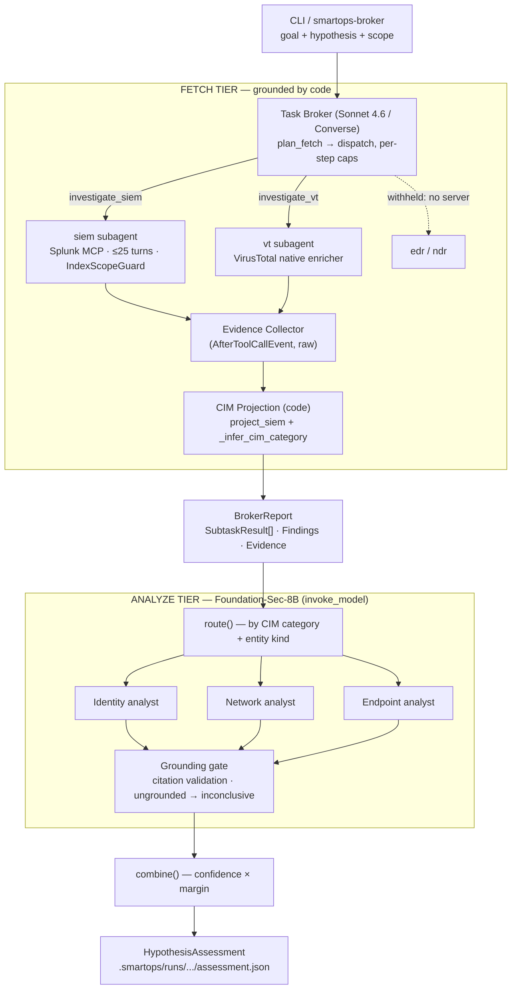

# SmartOps SOC — System Architecture

This is the consolidated, end-to-end architecture of the SmartOps SOC engine: how
one hypothesis becomes a grounded, cited conclusion. It covers both halves of the
pipeline — the **fetch** tier (Task Broker + domain subagents) and the newer
**analyze** tier (three domain analysts + a grounding gate).

> Related docs. `docs/agent_architecture.md` and
> `docs/confluence-task-broker-architecture.md` go deeper on broker internals and
> predate the analyst tier; `docs/PROJECT_DOCS.md` is the decision record (compiled
> from `docs/sessions/`). This file is the single map of the whole system.

---

## 1. Overview

The engine runs in two phases with a hard wall between them:

1. **Fetch (grounded by code).** A **Task Broker** (Claude Sonnet on Bedrock, via
   the Converse API) decomposes a goal into a bounded fetch plan and dispatches it
   to domain subagents — `siem` (Splunk over MCP) and `vt` (VirusTotal, native).
   The subagents retrieve telemetry; **code** — never a model — assembles the raw
   tool output into typed, cited `Findings`. The Broker is deliberately fenced out
   of drawing conclusions.

2. **Analyze (grounded by a gate).** Three **subagent-analysts** — identity,
   network, endpoint — each take the hypothesis plus their routed slice of the
   fetched evidence and decide whether it **supports**, **refutes**, or is
   **inconclusive** about the hypothesis. They run on a Bedrock **custom-imported**
   reasoning model (Cisco **Foundation-Sec-8B-Reasoning**, Llama-3.1-8B, 32k
   context). A citation-validation gate drops any fabricated citation and downgrades
   ungrounded decisive verdicts; a thin combiner rolls the three into one
   `HypothesisAssessment`.

The design invariant throughout: **conclusions must be grounded in evidence the
system actually retrieved, and neither a model's rows nor its citations are taken
on trust.**

---

## 2. Diagram



The same shape, ASCII (for terminals that do not render mermaid):

```
CLI → Task Broker (Sonnet) ─┬─ investigate_siem → Splunk MCP ─┐
                            └─ investigate_vt   → VirusTotal  ─┤
                               (edr/ndr withheld — no server)  │
                                                               ▼
                          Evidence Collector → CIM Projection (code)
                                                               ▼
                                    BrokerReport (typed Findings + Evidence)
                                                               ▼
                                 route()  →  identity / network / endpoint
                                        (Foundation-Sec-8B, invoke_model)
                                                               ▼
                          grounding gate → combine() → HypothesisAssessment
```

---

## 3. Fetch tier

### Task Broker — `smartops.broker`
An **agent, not an orchestrator**: its *choice of which family tool to call is the
classification decision*, so there is no separate classifier. It must call
`plan_fetch` to author a bounded `FetchPlan` before any dispatch, then dispatch each
step by `step_id`. Dispatch is bounded by code: `DISPATCHES_PER_PLANNED_STEP` (2 per
step) and `MAX_PLANNED_DISPATCHES_PER_FAMILY` (6), and every refusal is a returned
tool result so the model can self-correct. Runs on Sonnet via Converse; its
cumulative output ceiling is set by `--broker-output-tokens` (default 16000 — the
library default of 4000 is too low for Sonnet 4.6's thinking and caused
`limit_output_tokens` before any dispatch).

### siem subagent — `smartops.subagents`
A real Strands agent loop over the Splunk MCP toolset, up to `--subagent-turns`
turns (default **25**; library `DEFAULT_TURNS = 14`). It sees full tool results
(`SlidingWindowConversationManager(should_truncate_results=False)`), so it can
discover schemas, aggregate, and pivot indicators across turns. The system prompt
enforces **stopping conditions** (stop early once categories are covered, reserve
the final turn to report) and **CIM tagging** (every query reported in `queries_run`
with its category). Two guards apply:
- **`IndexScopeGuard`** (`smartops.guards`) cancels unconstrained / `index=*`
  searches before they run — a correctness/safety control, not full field
  optimization.
- **`superman-splunk` skill pack** (`smartops.skills`, `--skills` /
  `SMARTOPS_SKILLS_ENABLED`, **off by default**) injects a routing table + a
  `read_reference` tool giving `| tstats` datamodel guidance, SPL syntax, CIM
  schemas, sourcetypes, and investigation playbooks. Off by default so a measured
  run is a clean baseline.

### vt subagent — `smartops.tools.native.virustotal`
A model-free enricher: the entity kind selects the lookup, so `vt` answers with no
model and no MCP server. Reachable directly through native `@tool`s.

### edr / ndr
Registered as `DomainSpec`s but **withheld** from the Broker's toolset when no MCP
server is configured — a precondition (fact), not a judgement, so they are neither
planned nor dispatched today.

---

## 4. Evidence & CIM projection

The **two-layer payload** is the core anti-fabrication mechanism
(`contracts/findings.py`):
- **`Assessment`** is model-authored and small (a judgement about coverage).
- **`Findings`** is **code-assembled** from raw tool output and holds the rows.

`_EvidenceCollector` (`smartops.subagents`) captures raw tool output via an
`AfterToolCallEvent` hook, at `HookOrder.SDK_FIRST` so it records the true payload
before any offloader rewrites it. Per the `Evidence` contract, **raw output is never
shown to a model**; only code-assembled findings and citations cross that boundary.

`project_siem` (`smartops.projection`) buckets each result set into a CIM category:
`dns_resolutions`, `connections`, `processes`, `auth_events`. The category comes
from the model's own `QueryRun.category`; when that is missing, `_infer_cim_category`
derives it from the SPL predicates (e.g. `stream:dns` → dns_resolutions,
`EventCode=4688` → processes). Anything still untagged lands in `uncategorised` — an
**honesty bucket**: the rows were retrieved and paid for, so they are kept and
surfaced, never dropped. `VtFindings` carry projected reputation `VtVerdict`s.

---

## 5. Analyze tier (`smartops.subagent_analysts`)

The analysts consume the `BrokerReport`. Everything up to the model call is code.

- **Routing — `routing.py`.** `route(report, scope)` splits findings by CIM category
  and entity kind: identity ← `auth_events`; network ← `dns_resolutions` +
  `connections` + VT verdicts for ip/domain/url; endpoint ← `processes` + VT verdicts
  for file_hash. `uncategorised` sets are routed by the scope's entity kinds
  (`user`→identity, `host`→endpoint, ip/domain/url→network, file_hash/process→
  endpoint) and flagged — never dropped.
- **Formatting — `formatting.py`.** One dense, field-projected line per row, per
  record type (e.g. auth: `ts user src dest action app`; connections:
  `ts src:port→dst:port proto bytes action`). Each `ResultSet` renders under a
  citable header `# {category}#{index} · rows=N` — the query is deliberately **not**
  in the header, because a query written to test the hypothesis leaks it to an
  analyst that is structurally blind to it; it stays in `ResultSet.query`,
  `report.json`, `evidence.json`, and `Exhibit.query` for the Analyst Agent, which
  is not blind (see `formatting.format_result_set`). Rows come from `ResultSet.rows`
  (code-assembled) — never `Evidence.raw`.
- **Packing — `packing.py`.** Fits a slice into the 32k window via a row-cap ladder
  (20→10→…→header-only), highest-signal first (VT, then siem, then untagged), logging
  any truncation. Returns the evidence text **plus the set of valid header ids** for
  the grounding gate.
- **Prompts — `prompts.py`.** Each domain system prompt = the verbatim **Metis**
  preamble (the model's own trained persona, kept for safety/reasoning alignment)
  **augmented** with a hand-written, task-framed domain body: the exact evidence
  line-format it will see, its threat catalog, grounding rules, the untrusted-data
  security block, and the fixed verdict format. The user turn fences the hypothesis
  (escaped), scope, and evidence, reusing `guards.escape_untrusted` / `guards.fenced`.
- **Model — `model.py` (`AnalystModel`).** The imported model is driven by raw
  `invoke_model` (NOT Converse; no tool-calling, no structured output). The prompt
  template uses the model's registered special tokens and **seeds `<|assistant|>\n
  <think>\n`** so it reasons before answering. Payload:
  `{prompt, max_gen_len, temperature, top_p}`; response carries `generation` +
  token counts. Cold starts (`ModelNotReadyException`, from eviction) are retried
  with backoff. Credentials via `SMARTOPS_ANALYST_API_KEY` (ABSK bearer or
  ACCESS:SECRET) or the default AWS chain.
- **Parse — `parse.py`.** Split `generation` on `</think>` (reasoning kept as an
  audit trace, never re-fed; answer parsed). `parse_verdict` reads the labelled
  block, tolerant of the model's markdown emphasis (`**VERDICT:**`) by stripping
  `*`/backticks first. A malformed reply earns one bounded re-ask.
- **Verdict — `contracts/reasoning.py` (`AnalystVerdict`).** `domain`, `stance`,
  `confidence`, `rationale`, `key_observations`, `citations`, `reasoning_trace`, and
  per-verdict `prompt_tokens`/`generation_tokens`.

---

## 6. Anti-hallucination & grounding

Grounding is enforced at both tiers:

- **Fetch side:** raw evidence never enters a prompt; findings are projected by
  code; citations are minted by code; `IndexScopeGuard` bounds what can be queried.
  The fetch half structurally cannot fabricate rows.
- **Analyst side (`analyze.run_one` → `_finalize`):**
  - **Citation validation.** `pack_evidence` returns the exact set of header ids it
    emitted; any citation the model produces that is not in that set is **dropped**
    and logged (this has caught real fabrications live, e.g. a `uncategoried#49`
    typo).
  - **Grounding downgrade (the gate).** A `supports`/`refutes` verdict that resolves
    to **zero** valid citations is downgraded to `inconclusive` with capped
    confidence and a noted reason — a decisive claim with no evidence behind it does
    not stand.
  - **Context isolation.** The `<think>` reasoning trace is persisted for audit but
    never fed back into any prompt.
- **Empty-slice short-circuit.** A domain with no routed evidence returns
  `inconclusive` (confidence 0) **without** a model call — no invented citation, no
  wasted token.

---

## 7. Combine → HypothesisAssessment

`combine()` (`analyze.py`) is a thin, honest roll-up (a full aggregator is future
work): it is a **confidence-weighted vote scaled by margin**. Support and refute
sides sum their verdict confidences; the winner's confidence is the **mean of the
winning side's verdicts, scaled by its margin over the loser** — so two unopposed
0.88 supports roll up to ~0.88 (not a spurious 1.0), and opposition drives it toward
`inconclusive`. Ties and all-inconclusive panels resolve to `inconclusive`. The
result is a `HypothesisAssessment` (overall stance + confidence + the per-domain
verdicts, with token totals), persisted next to the broker artifacts at
`.smartops/runs/<task>/<timestamp>/assessment.json`.

---

## 8. Models & configuration

| Concern | Broker (fetch) | Analysts (analyze) |
|---|---|---|
| Model | Claude Sonnet 4.6 | Foundation-Sec-8B-Reasoning (Cisco) |
| Bedrock API | Converse | custom-imported → `invoke_model` |
| Tools / structured output | yes (Strands `@tool`, structured output) | none (raw text in/out) |
| Reasoning | thinking | `<think>…</think>`, seeded |
| Cost model | per-token (tracked by `Budget`) | per model-copy-**minute** (warm time), not per token |
| Context | large | **32,768** tokens (prompt + generation) |

Key env / CLI knobs:
- `SMARTOPS_ANALYST_MODEL_ARN`, `SMARTOPS_ANALYST_API_KEY`,
  `SMARTOPS_ANALYST_TEMPERATURE` (0.6 default), `SMARTOPS_ANALYST_TOP_P` (0.95),
  `SMARTOPS_ANALYST_MAX_GEN_LEN` (3072), `SMARTOPS_ANALYST_READY_RETRIES` / `_WAIT_SECONDS`.
- `--hypothesis` (enables the analyst tier), `--broker-output-tokens` (default 16000),
  `--subagent-turns` (default 25), `--skills` / `--no-skills`
  (`SMARTOPS_SKILLS_ENABLED`), `--budget-usd`.
- Analyst token usage is reported per verdict and in total every run; the hard
  per-call limit is the 32k context window (headroom ≈ 32768 − prompt tokens).

---

## 9. Contracts (the typed spine)

`contracts/` is a separate workspace member consumed by every tier.

| Contract | Role |
|---|---|
| `AnalystTask` | Analyst → Broker intent: `{hypothesis_id, goal, scope}` |
| `Scope` / `Entity` | authorization boundary: entities + time window |
| `FetchPlan` / `FetchStep` / `CompletionRule` | the Broker's code-evaluated plan |
| `SubagentMission` | one dispatched fetch mission (goal + scope only) |
| `SubtaskResult` / `Evidence` / `Findings` | a subagent's result; raw evidence + typed rows |
| `SiemFindings` / `VtFindings` / `ResultSet` | per-family projected payloads (CIM buckets, verdicts) |
| `StepOutcome` / `BrokerReport` | per-step evaluation; the full fetch record |
| `InvestigationContext` | the "why" for the analysts: `{hypothesis, seed_event?}` |
| `AnalystVerdict` | one domain analyst's grounded conclusion |
| `HypothesisAssessment` | the rolled-up result of the analyze tier |

---

## 10. Data-flow example (coinhive / BSTOLL-L)

1. CLI: goal + `--hypothesis "Host BSTOLL-L was cryptomining via coinhive.com"` +
   entities `domain:coinhive.com`, `host:BSTOLL-L`.
2. Broker plans 4 steps (vt reputation; siem dns / connections / processes) and
   dispatches vt + siem.
3. Splunk returns real BOTSv3 rows; VT returns coinhive.com (mal=11). Code projects
   `dns_resolutions`, `connections`, some `uncategorised`, and a VT verdict.
4. `route()` sends dns/connections + VT(domain) → network, processes → endpoint,
   uncategorised (host) → endpoint; auth → identity (empty → short-circuit).
5. Each analyst reasons over its slice, emits `<think>…</think>` then a VERDICT
   block; the gate validates citations against the emitted header ids.
6. `combine()` rolls the verdicts into an overall stance + confidence; the
   assessment is printed and saved. (Observed: grounded per-domain verdicts,
   INCONCLUSIVE overall — reconnaissance without miner execution — a defensible SOC
   outcome.)

---

## 11. Known limitations & follow-ups

- **SIEM CIM-categorization gap.** The siem subagent often does not tag queries with
  a CIM category, so evidence falls into `uncategorised`; `_infer_cim_category` is a
  fallback, not a cure. Uncategorised evidence fans out by entity kind and can dilute
  a domain's slice. Highest-leverage fix is reliable categorization at the siem tier.
- **Analyst verdict variance.** At the model's default `temperature 0.6`, verdicts
  can vary run-to-run on identical evidence. A stability sweep (temps 0.2/0.3/0.6) is
  planned; 0.3 is Cisco's benchmarked setting.
- **Budget escrow tradeoff.** The subagent escrow hold was calibrated to expected
  (not worst-case) turns to allow concurrency under tight budgets; this trades away
  part of the hard overspend guarantee. A per-investigation output-token ceiling is
  planned to restore it.
- **edr / ndr not wired.** No MCP servers configured; the families are withheld.
- **Aggregator.** The current `combine()` is intentionally thin; a richer downstream
  Aggregator is future work.
