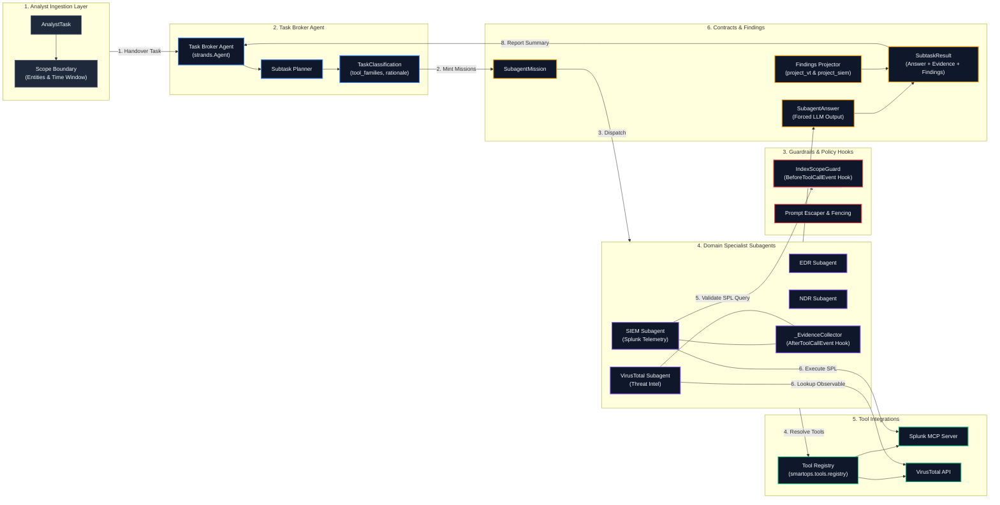
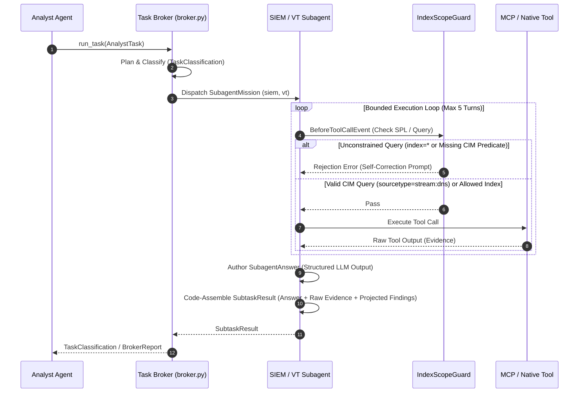

# SmartOps SOC Architecture Specification & Diagrams

This document provides a clean, executive-ready technical specification and architectural diagrams for **SmartOps SOC App**, detailing the multi-agent topology, data contract pipeline, security guardrails, and tool integration interfaces.

---

## 🏛️ System Architecture Flow

---

## 🔄 Interaction Sequence & Execution Flow

---

## 🧱 Component Architecture Reference

| Layer | Primary Module | Responsibility & Key Mechanisms |
|---|---|---|
| **Analyst Ingestion** | `smartops.contracts` | Receives tool-agnostic `AnalystTask` (`goal`, `scope`). Enforces domain dispatch preconditions in code. |
| **Task Broker Agent** | `smartops.broker` | Orchestrates investigation using Agents-as-Tools pattern. Generates `TaskClassification`. |
| **Guardrails & Policies** | `smartops.guards` | `IndexScopeGuard` inspects SPL via `BeforeToolCallEvent`. Allows Splunk CIM predicates (`sourcetype`, `datamodel`, `tag`, `eventtype`) while blocking `index=*`. |
| **Domain Subagents** | `smartops.subagents` | Isolated execution contexts capped at 5 turns (`DEFAULT_TURNS = 5`). Collects raw evidence using `_EvidenceCollector` (`HookOrder.SDK_FIRST`). |
| **Tool Registry** | `smartops.tools.registry` | `tools_for(family)` dynamically resolves native `@tool` functions and MCP server clients (`mcp_servers.json`). |
| **Contracts & Projection** | `smartops.projection` | Assembles `SubtaskResult` by wrapping `SubagentAnswer` with code-projected `VtFindings` (`project_vt()`) and `SiemFindings`. |
