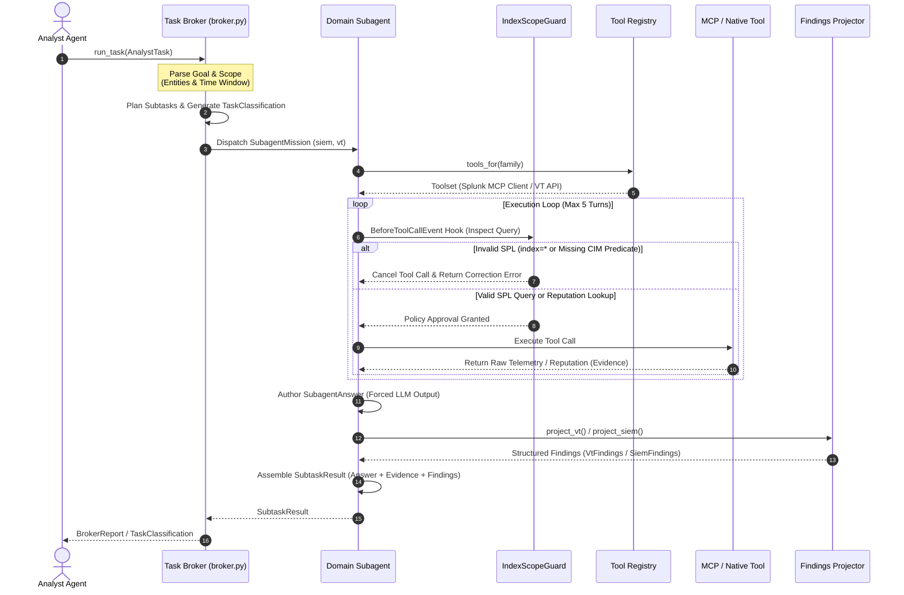

# SmartOps SOC Execution Sequence Diagram

This document presents the complete sequence and data flow diagram for **SmartOps SOC App**, tracking the step-by-step lifecycle from analyst task handover to subagent planning, guardrail policy verification, tool execution, findings projection, and report assembly.

---

## 🔄 End-to-End Execution Sequence Diagram

---

## 📋 Sequence Flow Breakdown

1. **Analyst Handover**: The Lead Analyst Agent invokes `run_task(AnalystTask)` providing tool-agnostic goals and scope boundaries (`entities`, `time_window`).
2. **Broker Classification**: Task Broker Agent parses the handover, evaluates preconditions, and dispatches subtasks (`SubagentMission`).
3. **Tool Resolution**: `tools_for(family)` resolves active MCP clients (Splunk MCP Server) and native `@tool` functions (VirusTotal REST API).
4. **Guardrail Enforcement**: `IndexScopeGuard` intercepts queries via `BeforeToolCallEvent`. SPL searches must target explicit indexes (`index=botsv3`) or standard Splunk CIM predicates (`sourcetype`, `datamodel`, `tag`, `eventtype`). Unconstrained `index=*` queries are cancelled with self-correction feedback.
5. **Findings Projection**: Domain subagents author forced `SubagentAnswer` output. Code wraps the answer with raw `Evidence` and projected `VtFindings` (`project_vt()`) or `SiemFindings` into `SubtaskResult`.
6. **Final Report Assembly**: Subtask results return to the Task Broker to compile the unified `BrokerReport`.
